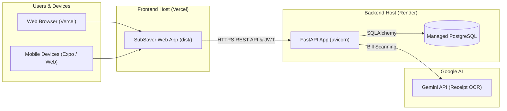

# SubSaver Full-Stack Deployment Guide

This guide walks you through deploying SubSaver to production with a **free / cost-effective stack**:
- **Backend & Database**: [Render](https://render.com) (FastAPI Web Service + Managed PostgreSQL Database)
- **Frontend**: [Vercel](https://vercel.com) (React Native for Web SPA with global CDN)
- **Alternative**: Self-hosted [Docker Compose](docker-compose.yml) on any Linux VPS (AWS, DigitalOcean, Hetzner, etc.)

---

## Architecture Overview



---

## Part 1: Deploy Backend & PostgreSQL on Render

### Method A: 1-Click Render Blueprint (Recommended)

SubSaver includes a pre-configured `render.yaml` file that automatically sets up both the PostgreSQL database and the FastAPI Web Service:

1. **Push your code to GitHub**:
   ```bash
   git add .
   git commit -m "Configure full-stack deployment for Render and Vercel"
   git push origin main
   ```
2. Log in to [Render](https://dashboard.render.com).
3. Click **New +** > **Blueprint**.
4. Connect your **SubSaver** GitHub repository.
5. Render will detect `render.yaml` and display:
   - **Database**: `subsaver-db` (Free tier PostgreSQL)
   - **Web Service**: `subsaver-api` (Python / FastAPI)
6. Add your environment variables:
   - `GEMINI_API_KEY`: Enter your Google Gemini API key (optional for AI receipt scanning).
7. Click **Apply**.
8. Render will provision the database and deploy your FastAPI backend. Once deployed, note down your backend URL:
   ```text
   https://subsaver-api-xxxx.onrender.com
   ```
9. Verify health by opening `https://subsaver-api-xxxx.onrender.com/health` in your browser. You should see:
   ```json
   {"status": "healthy"}
   ```

---

### Method B: Manual Render Setup (Step-by-Step)

If you prefer setting up the services manually without Blueprints:

#### 1. Create the PostgreSQL Database
1. In Render Dashboard, click **New +** > **PostgreSQL**.
2. Name: `subsaver-db`
3. Database: `subsaver`
4. User: `postgres`
5. Plan: **Free**
6. Click **Create Database**.
7. Once created, copy the **Internal Database URL** (or External URL).

#### 2. Create the FastAPI Web Service
1. Click **New +** > **Web Service**.
2. Connect your GitHub repository.
3. Configure the service:
   - **Name**: `subsaver-api`
   - **Root Directory**: `Backend`
   - **Runtime**: `Python` (or `Docker`)
   - **Build Command**: `pip install -r requirements.txt`
   - **Start Command**: `uvicorn app.main:app --host 0.0.0.0 --port $PORT`
4. Under **Environment Variables**, add:
   | Key | Value |
   |---|---|
   | `DATABASE_URL` | *(Paste the PostgreSQL connection URL from Step 1)* |
   | `SECRET_KEY` | *(A long random string, e.g. `openssl rand -hex 32`)* |
   | `GEMINI_API_KEY` | *(Your Google Gemini API Key)* |
5. Click **Create Web Service**.

---

## Part 2: Deploy Frontend on Vercel

### Step 1: Import Project to Vercel

1. Log in to [Vercel](https://vercel.com).
2. Click **Add New...** > **Project**.
3. Import your **SubSaver** GitHub repository.

### Step 2: Configure Project Settings

In the Vercel **Configure Project** screen:

1. **Framework Preset**: Select **Other**.
2. **Root Directory**: Click **Edit** and select `Mobile`.
3. **Build and Output Settings**:
   - **Build Command**: Override and set to:
     ```bash
     npx expo export -p web
     ```
   - **Output Directory**: Override and set to:
     ```bash
     dist
     ```
   - **Install Command**: `npm install`
4. **Environment Variables**:
   Add the following environment variable pointing to your deployed Render backend:
   | Key | Value |
   |---|---|
   | `EXPO_PUBLIC_API_URL` | `https://subsaver-api-xxxx.onrender.com` |
   *(Replace with your actual Render API URL without trailing slash)*

5. Click **Deploy**.

Vercel will install dependencies, build the static bundle via Expo for Web, and publish your site with single-page app (SPA) rewrites using `Mobile/vercel.json`.

---

## Part 3: Verify the Live Deployment

1. **Open your Vercel URL**:
   `https://subsaver-xxxx.vercel.app`
2. **Test Register / Login**:
   - Register a new account (e.g. `test@subsaver.com`).
   - The frontend will send the request to your Render API.
   - The Render API will store the credentials in your PostgreSQL database and return a JWT token.
3. **Test Core Features**:
   - Create a group.
   - Add a shared subscription or expense.
   - Check the Emerald dashboard metrics and charts.

---

## Part 4: Alternative – Self-Hosting with Docker Compose

If you have a Linux VPS (Ubuntu, Debian, etc.), you can run the entire backend + database with one command:

1. Clone your repository onto the server:
   ```bash
   git clone https://github.com/your-username/SubSaver.git
   cd SubSaver
   ```
2. Create your `.env` file in `Backend/`:
   ```bash
   cp Backend/.env.example Backend/.env
   ```
3. Start the containers using `docker-compose.yml`:
   ```bash
   docker compose up -d --build
   ```
4. Verify containers are running:
   ```bash
   docker compose ps
   curl http://localhost:8000/health
   ```
